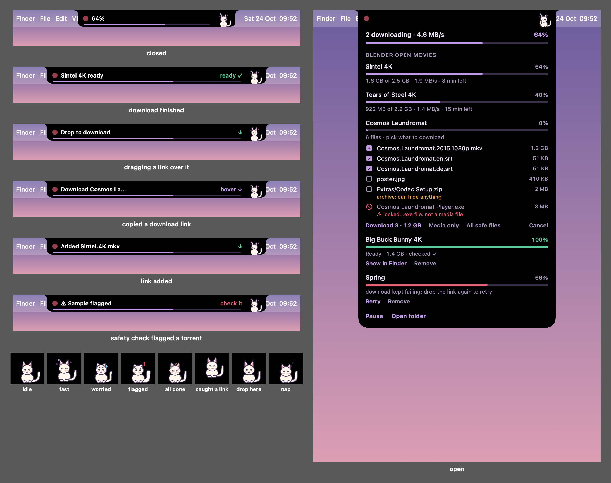
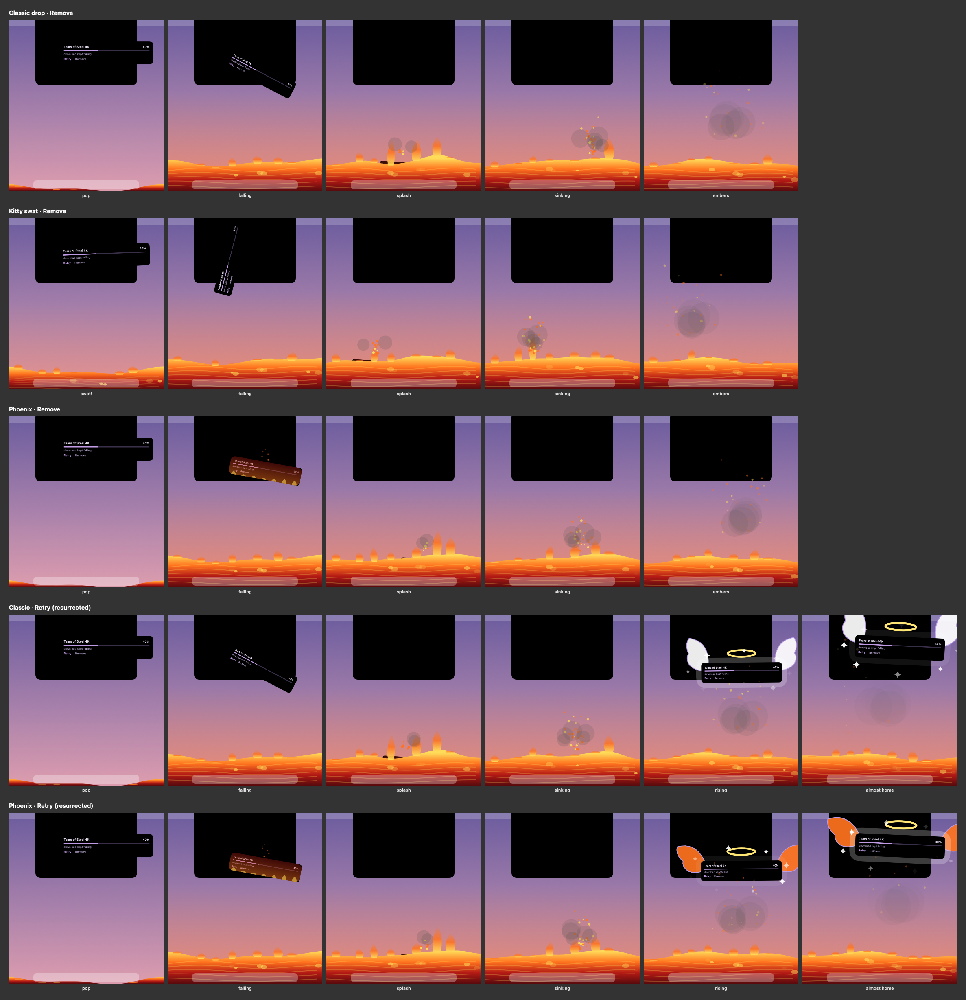
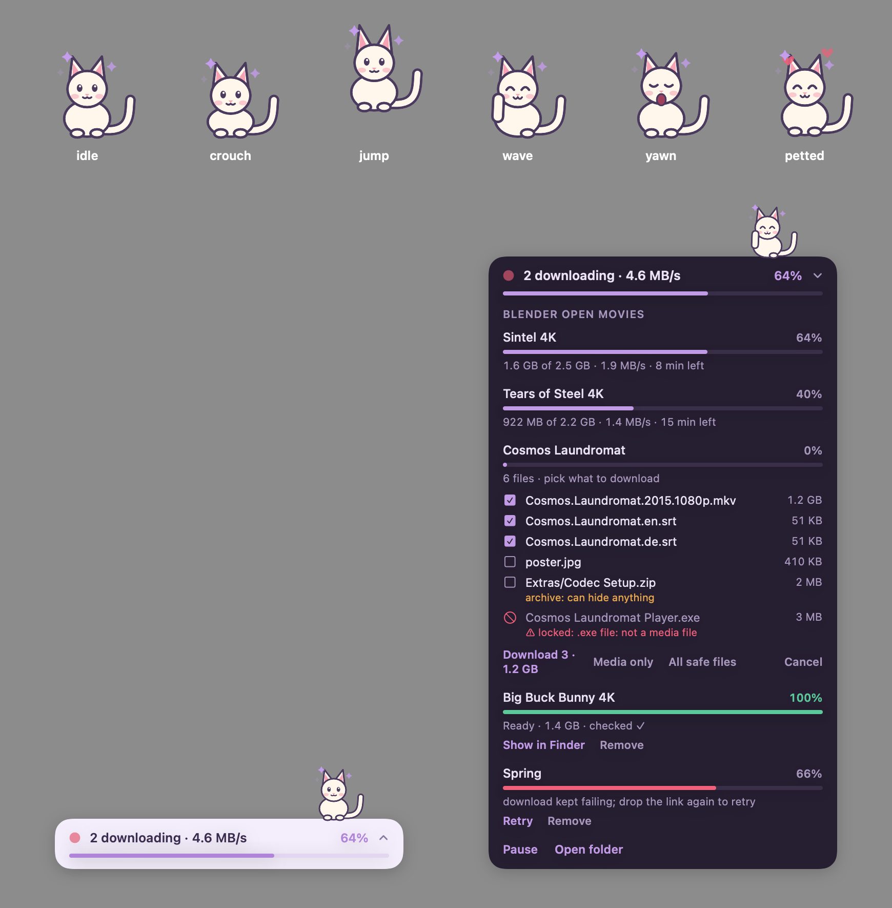

# Purrload

**A tiny download manager for macOS with a cat on top.**

Purrload keeps your Safari downloads alive. It stops your Mac from sleeping mid-download, notices stalls and dropped connections, resumes from the exact byte where a download stopped, and checks every file when it finishes. Progress shows in your MacBook's notch, or in a small floating bar, where a kitty naps, yawns and waves while your files come in.



## Features

**Lives in the notch**
- The notch extends into a slim black strip showing overall progress, with the kitty sitting just right of it.
- Hover to drop it down into a full list of downloads; move away and it tucks itself back up.
- When a download finishes and passes its check, the strip briefly widens to say so.
- No notch, or using an external display? It becomes a floating bar in the corner instead (right-click to switch).

**Drop to download**
- Drag a link, magnet link or `.torrent` file onto the notch: the strip opens wide to say "Drop to download", and the kitty gets ready to catch it.
- Copy a download link (a magnet, or a web link to a `.mkv`, `.zip`, `.dmg`, …) and the notch offers to download it. Ordinary page links are ignored. You can turn this off with a right-click.
- Web downloads go to `~/Downloads` (8 connections per file with aria2, otherwise curl), with the same resume, retry and network-switch recovery.
- **Pick what you want from a torrent.** Before anything downloads, the notch shows every file with a tick box. Video, audio and subtitles are ticked for you, extras like posters or `.nfo` files can be added, and anything the safety check flags (disguised apps, `.exe` files, double extensions) is locked with the reason shown.
- After downloading, torrents are checked again by content and get the quarantine mark.
- **Click a magnet link or open a `.torrent` file** and it goes straight to Purrload. If another torrent app is set as the default, right-click → **Open magnet links and .torrent files** to switch back.
- Running downloads get **Pause** and **Cancel**. A paused download stays paused after a restart, and lets the Mac sleep. Cancel deletes what was downloaded so far, but never a torrent folder that was already there before.
- Finished downloads get **Show in Finder**, failed ones get **Retry**, and both can be cleared with **Remove**.

**Choose where downloads go**
- Click the little cat-folder in the open notch to pick a recent folder or **Choose another folder…**. Downloads go straight into it (until you pick one, torrents go to `~/Downloads/Torrents`).
- A torrent can be sent somewhere else from its file picker (**Save to**), without changing the default.
- If the folder is on a drive that isn't plugged in, Purrload says so instead of saving somewhere else.

**The floor is lava**
- Click **Remove** and the row falls out of the notch into a lava floor that rises across the bottom of the screen, and burns.
- Click **Retry** and it falls in, burns, then rises back out with a halo and wings while the download starts again.
- Three styles (right-click → Remove animation): **Classic drop**, **Kitty swat** (the kitty knocks it off the edge, as cats do), and **Phoenix** (it catches fire on the way down). Or turn it off.
- It's drawn in a click-through overlay that only exists while it plays, and it respects macOS's "Reduce motion" setting.



**A kitty with moods**
- It hops and sparkles when downloads are fast, and looks worried (with a sweat drop) when they stall or the network drops.
- It puffs up with a red "!" when the safety check flags a torrent.
- It throws confetti when everything is finished, and naps when there's nothing to do. Click it to pet it.

**Keeps downloads alive**
- Keeps the Mac awake while anything is downloading.
- Watches each file's real size on disk, so a download that has silently stopped growing gets caught.
- Picks up a failed or stalled Safari download from the exact byte where it stopped, using HTTP range requests and automatic retries.
- Restarts stuck connections right away when your network changes (Wi-Fi to hotspot, for example).
- Warns you when a time-limited download link will expire before the file finishes.
- Checks every finished file: exact size, plus a valid video header for video files.

**Faster downloads (optional, needs [aria2](https://aria2.github.io/))**
- `purr` continues Safari's in-progress downloads with up to 16 connections per file.

**Safer torrents (optional, needs aria2)**
- `purr <magnet link | file.torrent>` lists the files before downloading, and by default fetches only video, audio and subtitles.
- It checks what each file *actually contains*, so a "video" that is really an app or a script gets flagged.
- It flags double extensions (`movie.mkv.exe`), hidden right-to-left characters in names, and installers, scripts and archives.
- Every downloaded file gets macOS's quarantine mark, so Gatekeeper still checks anything you open.
- These checks help catch disguised files. They don't replace antivirus software.



## Requirements

- macOS 14 or later (notch mode needs a MacBook with a notch)
- Xcode or the Xcode Command Line Tools (`xcode-select --install`)
- Python 3 (included with the Command Line Tools)
- Optional: aria2 (`brew install aria2`) for `purr` and torrents

## Install from source

```sh
git clone https://github.com/Pranil-sekuru/purrload.git
cd purrload
scripts/install.sh
```

The install script:
1. Builds `Purrload.app`, copies it to `~/Applications` and opens it.
2. Links the `purr` commands into `~/.local/bin`.

The app starts the engine itself. On first launch it asks whether to keep downloading after you quit it (see below).

## What Purrload does on your Mac

Everything here is optional unless it says otherwise, and **right-click → Background engine → Uninstall Purrload…** undoes all of it. Files you downloaded are never touched by uninstalling.

**Always**
- Keeps its data in `~/Library/Application Support/Purrload`: the download list (`jobs.json`, readable only by you, because download links can contain access tokens), status, logs, settings, and copies of `.torrent` files you open. Its preferences are under `io.github.pranil-sekuru.purrload`.
- Keeps the Mac awake (`caffeinate`) while something is downloading, and lets it sleep again when nothing is, including when the only downloads left are paused.
- Marks downloaded files with macOS's quarantine flag, so Gatekeeper checks anything you open, as it does for Safari downloads.
- Becomes the app that opens `magnet:` links and `.torrent` files, unless another app already is (right-click → **Open magnet links and .torrent files** to change it).

**Only if you say yes**
- **Keep downloading after Purrload quits** (asked on first launch): adds a background agent, `~/Library/LaunchAgents/io.github.pranil-sekuru.purrload-engine.plist`, that runs `Purrload --engine` at login and restarts it if it stops. Without it, downloads run only while Purrload is open.
- **Open Purrload at login**: a normal login item, listed in System Settings → General → Login Items.
- **Notifications**: posted when a download finishes or needs you.
- **Full Disk Access**: needed only to rescue Safari downloads, because Safari's download list is protected. Purrload asks once. Grant it to Purrload in System Settings → Privacy & Security → Full Disk Access; everything else works without it.

**What it reads**
- Safari's download list (with Full Disk Access) and the files being downloaded.
- The clipboard, only to spot copied download links. This stays on your Mac; right-click → **Offer copied download links** turns it off.

**Network**
- Only the downloads you start, plus the BitTorrent network (peers, DHT, peer exchange) for torrents. No telemetry, no analytics, no update checks, and no extra trackers added to your torrents.

## Usage

| Command | What it does |
|---|---|
| `purrload-engine` | Start the engine from a terminal (only if you don't use the app's background engine) |
| `purr-progress` | Live view of downloads in the terminal |
| `purr` | Continue Safari's in-progress downloads with multiple connections |
| `purr --resume` | Continue an interrupted `purr` run |
| `purr "magnet:?…"` or `purr file.torrent` | Safe torrent download (`--to DIR`, `--seed`, `--all`, `--trust`) |

- **Pause one download:** click **Pause** on its row. **Pause everything:** right-click the notch or bar, or create a `PAUSE` file in the data folder (handy on metered data).
- **Pet the kitty:** click it.

## How it works

Purrload has two halves that talk through a single status file:

- **The engine** (`engine/purrload-engine.py`) watches Safari's download list and each file on disk. It keeps the Mac awake, takes over failed or stalled downloads with `curl`, and checks finished files. It also runs downloads the app queues in its `inbox/` folder. It keeps the current state in `status.json`.
- **The app** (`app/`, SwiftUI) reads `status.json` and draws the notch or bar, plus the kitty. When you drop or accept a link, the app writes a small request file into the engine's `inbox/` folder. The app never downloads anything itself, so quitting it doesn't stop your downloads.

Runtime data lives in `~/Library/Application Support/Purrload` (set `PURRLOAD_HOME` to change it). Nothing is ever sent anywhere: Purrload has no telemetry, no analytics and no network access of its own apart from the downloads you start. Download links can contain access tokens, so they are never written to logs.

## Development

```sh
scripts/build.sh                 # build ./build/Purrload.app
scripts/build.sh --install       # build, copy to ~/Applications, relaunch
build/Purrload.app/Contents/MacOS/Purrload --demo --snapshot-notch out.png   # render the notch to an image
build/Purrload.app/Contents/MacOS/Purrload --stress out.log --mode notch     # open/close stress test
build/Purrload.app/Contents/MacOS/Purrload --selftest out.log                # link detection + inbox checks
build/Purrload.app/Contents/MacOS/Purrload --pit-demo all                     # watch the lava floor live (~20 s)
build/Purrload.app/Contents/MacOS/Purrload --pit-stress out.log               # 100 cards: fps, click-through, memory
build/Purrload.app/Contents/MacOS/Purrload --pit-storyboard out.png           # every style, frame by frame
scripts/make-icon.sh                                                          # regenerate the app icon
```

Animated symbols (sparkles, the kitty's "z"s) are drawn as shapes, not `Text`: drawing text in a Canvas that redraws every frame made memory grow without limit.

The stress test opens and closes the notch or bar 60 times like real clicks, at speeds up to one toggle every 50 ms. It reports:
- window moves and resizes (should be 0)
- the kitty's frame rate
- whether clicks land in the right places (the menu bar beside the notch must stay clickable)
- whether hover-to-open behaves correctly

## Roadmap

- Safari extension: "Download with Purrload" in the right-click menu (needs Xcode)
- Swift download engine built on aria2's remote-control (JSON-RPC) interface, replacing the Python engine
- Settings window: download folder, connections, speed limit, auto-pause on mobile hotspot data
- Signed and notarized releases, Homebrew cask, automatic updates

## License

MIT. See [LICENSE](LICENSE). aria2 is a separate GPL program that Purrload calls if it's installed; it isn't bundled.
